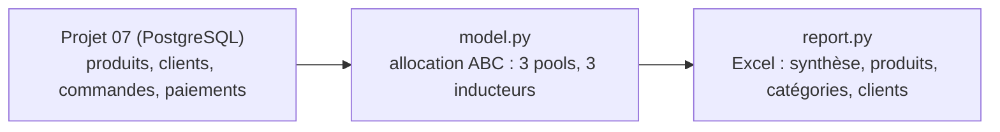

# Projet 17 — Rentabilité produit/client (ABC costing)

[](https://github.com/valentinratigniet-byte/projet-17-rentabilite-produit-client/actions/workflows/ci.yml)

> Un produit rentable en marge brute peut détruire de la valeur une fois les
> coûts indirects réellement alloués. Ce projet applique une **allocation
> ABC (Activity-Based Costing)** — logistique, paiement, SAV, chacun rattaché
> à son véritable inducteur — sur les 2 000 produits et 5 000 clients de la
> base du [Projet 07](https://github.com/valentinratigniet-byte/projet-07-base-ecommerce),
> plutôt qu'une répartition naïve au prorata du chiffre d'affaires.

## 🎯 Problème métier

"Ce produit fait 25 % de marge brute" ne dit pas s'il est rentable à vendre.
S'il se vend en toutes petites lignes de commande, le coût de traitement
(pick, pack, expédition) peut dépasser la marge qu'il génère — invisible
dans un tableau de marge brute, invisible aussi dans une allocation de coûts
au prorata du CA (qui dilue le problème sur tout le catalogue). Il faut
allouer le coût là où l'activité a réellement lieu.

## 📄 La note d'analyse

**[docs/analyse.md](docs/analyse.md)** — méthode, résultats, et une
conclusion assumée : le signal produit est réel et actionnable, le signal
client ne l'est pas sur ce jeu de données (et le rapport dit pourquoi,
plutôt que de forcer une segmentation qui n'existe pas).

## 📊 Résultats mesurés

| | Valeur |
|---|---:|
| Produits à marge nette négative | **9 / 2 000** |
| Pire cas | **-29,0 %** de marge nette (produit à 2,54 €, 42 lignes) |
| Seuil de rentabilité | **~12,80 € de CA par ligne de commande** |
| Marge nette par catégorie | homogène, 24,44 % à 24,50 % |
| Marge nette par client (1ᵉ-99ᵉ centile) | homogène, 21,5 % à 24,2 % |

## 🗂️ Architecture



Trois pools de coûts indirects, chacun avec son propre inducteur (pas une
seule clé de répartition globale) :

| Pool | Inducteur | Coût |
|---|---|---:|
| Logistique | nb de lignes de commande | 3,20 €/ligne |
| Paiement | montant réel × méthode réelle | 1,4 % carte / 2,9 % PayPal / 0,40 € virement |
| SAV | nb de commandes (+ surcoût si annulée) | 1,80 €, +9,00 € si annulée |

Le CA, les lignes, les méthodes de paiement sont **mesurés** (requête directe
sur le Projet 07). La marge brute et les coûts par inducteur sont des
**hypothèses**, listées explicitement dans l'onglet "Hypothèses" du rapport —
jamais mélangées avec le mesuré (même discipline que le
[Projet 16](https://github.com/valentinratigniet-byte/projet-16-business-case-investissement)).

Trois réconciliations vérifiées par `assert` (`self_check`) : le CA cumulé
par produit et par client doit boucler exactement sur le CA total mesuré en
base — un bug d'agrégation romprait ces identités avant de publier un
chiffre faux.

## 🚀 Reproduire

Prérequis : la base du [Projet 07](https://github.com/valentinratigniet-byte/projet-07-base-ecommerce)
doit tourner et être seedée (port 5433).

```bash
pip install -r requirements.txt
python src/model.py    # constats + self-check (console)
python src/report.py   # dossier Excel complet
```

Sortie : `output/rentabilite_<AAAA-MM-JJ>.xlsx`. Exemple versionné :
`output/exemple_rentabilite.xlsx`.

## 🗃️ Structure du repo

```
projet-17-rentabilite-produit-client/
├── README.md
├── docs/
│   └── analyse.md      ← méthode, résultats, recommandations
├── src/
│   ├── model.py         ← allocation ABC (3 pools) + self-check (réconciliations)
│   └── report.py        ← export Excel (synthèse, produits, catégories, clients)
└── output/
    └── exemple_rentabilite.xlsx
```

## 🧠 Choix de conception notables

- **Trois inducteurs, pas une seule clé de répartition** : allouer tous les
  coûts indirects au prorata du CA aurait masqué le problème produit — les
  9 SKU concernés pèsent trop peu dans le CA total pour ressortir dans un
  ratio global.
- **Le signal client négatif est rapporté tel quel** : la marge nette par
  client est homogène sur ce jeu de données (commandes attribuées ~au hasard
  par Faker, sans biais comportemental) — plutôt que de forcer une
  segmentation artificielle, le rapport explique pourquoi et où la même
  méthode serait plus révélatrice (données réelles).
- **Cohérence inter-projets** : marge brute (25 %) et surcoût SAV des
  commandes annulées reprennent les hypothèses/constats déjà posés au
  Projet 16 (7,18 % d'annulation) — pas des chiffres qui changent d'un
  projet à l'autre sans raison.

---

*Projet 17 du [Portfolio Data](https://github.com/valentinratigniet-byte). Réutilise la base du
[Projet 07](https://github.com/valentinratigniet-byte/projet-07-base-ecommerce) et l'hypothèse de marge du
[Projet 16](https://github.com/valentinratigniet-byte/projet-16-business-case-investissement). Dernier volet
du triptyque contrôleur de gestion/business analyst (15 → 16 → 17).*
